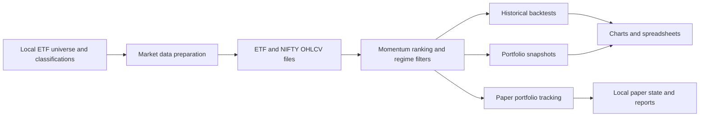

# Indian ETF Momentum

Python research workflows for Indian ETF momentum ranking, portfolio rebalancing, historical simulation and paper-portfolio tracking. Compare weekly, biweekly and monthly schedules across Conservative, Balanced and Aggressive portfolios.

## Workflow



This is a conceptual workflow. The scripts are standalone research programs with some duplicated calculations; they are not stages of a single automated runner.

## What is included

| Files | Purpose |
|---|---|
| `strategy_w.py`, `strategy_biw.py`, `strategy_m.py` | Rank ETFs and describe rebalance actions |
| `backtest_w.py`, `backtest_biw.py`, `backtest_m.py` | Compare portfolios with NIFTY and export historical results |
| `portfolio_w.py`, `portfolio_biw.py`, `portfolio_m.py` | Generate portfolio snapshots and Word/Excel reports |
| `paper_w.py`, `paper_biw.py`, `paper_m.py` | Maintain local simulated portfolio state |
| `update_data.py` | Fetch adjusted daily ETF and NIFTY data through yfinance |
| `nifty_ohlc.py` | Standalone NIFTY download utility |

Suffixes: `w` = weekly, `biw` = biweekly, `m` = monthly. Paper tracking is simulated accounting, not evidence of real execution quality.

## Setup

Use a Python 3 environment and run commands from the repository root. A minimum Python version and dependency lockfile have not yet been established.

```powershell
python -m venv .venv
.venv\Scripts\python -m pip install -r requirements.txt
```

On macOS/Linux use `.venv/bin/python` in place of `.venv\Scripts\python`.

The dependency list covers imports and spreadsheet/report engines used by the included scripts. Versions are unpinned; clean-environment installation and end-to-end execution have not been verified for this release.

## Prepare local inputs

Follow [the data guide](docs/data.md) to supply your own authorized universe, classification and price files. Raw market data and personal output files are not distributed.

If using the supplied downloader, create the universe/classification inputs first, then run:

```powershell
.venv\Scripts\python update_data.py
```

This downloads data over the network and writes local files. It is not required if equivalent inputs already exist. Provider availability and data-use terms are your responsibility.

## Run an experiment

Inspect the configuration constants and `main()` function in the chosen script before running. Historical dates and capital assumptions are embedded in the source; some default windows end in March 2026.

With valid local inputs, a weekly historical simulation is started with:

```powershell
.venv\Scripts\python backtest_w.py
```

Use `backtest_biw.py` or `backtest_m.py` for other frequencies. Reports and figures are generated in the working directory and may replace previous outputs. Review results before running portfolio or paper-tracking scripts. Paper scripts persist `state_paper_*.json`; keep that state private and use separate working copies for independent experiments.

## Research limitations

- Universe selection may introduce survivorship bias; use point-in-time membership for a stronger evaluation.
- Transaction costs, liquidity, spreads, ETF tracking error and signal timing need independent validation.
- Frequency variants contain separate implementations; review their assumptions before comparing results.
- No performance headline is asserted here. Existing local results were not independently reproduced for publication.
- Source syntax was checked before upload. This is not a completed strategy audit or deployment certification.

## Security and scope

Only selected source and documentation are included. Credentials, populated environment files, raw datasets, personal reports, presentations, historical paper state, backups and local Git history are excluded. The included workflows do not require a broker API credential.

The publication copy changes the weekly strategy metadata directory to the repository working directory for portability. The original local research files are unchanged.

## License

No open-source license has been selected. Public availability alone does not grant general permission to reuse or redistribute the code.
